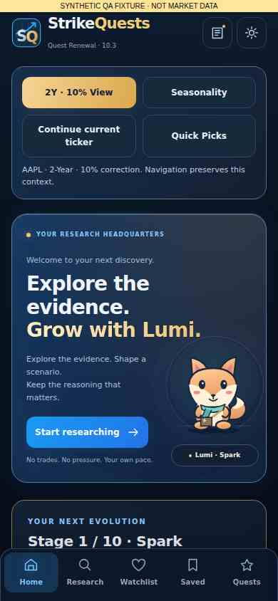
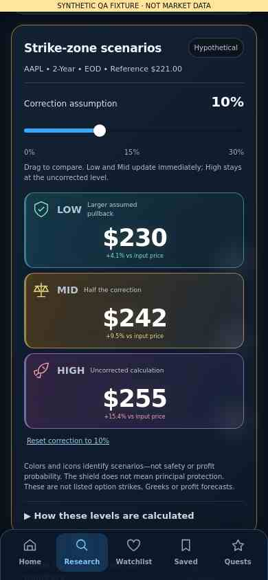
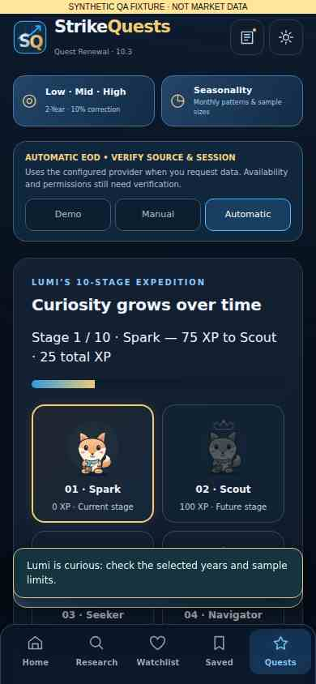

# StrikeQuests 10.3 — actual app preview

These are genuine screenshots of the implemented release candidate, not artwork or mockups. They were captured from the running app during the successful 73-check production-composition test. All prices and research data shown are **synthetic QA fixtures**.

**Not yet published.** These screenshots do not establish working live EOD delivery. The existing shared EOD service failed its separate operational test; the working-data release condition remains unresolved. Public account sign-in/recovery and physical iPhone testing remain unverified. No backend or production changes are made by this gallery.

## Home
Blue-and-gold presentation, contextual Lumi, research status and quick actions. Chromium emulation, 390 × 844 pixels.

## Research
The preferred 2-Year / 10% scenario path and more distinct Low/Mid/High presentation. WebKit emulation, 390 × 844 pixels; not a physical iPhone.

## Quests
Expanded research progression. The implemented journey has ten slower Lumi stages and 24 additional expedition badges; the phone screenshot captures only the visible portion of this screen. New expedition badges remain device-local, not cloud-synced.

## Exact source and verification
Candidate: `332027278d989b18e2098f21d08d8416e6d8b4ca`. [Successful synthetic verification run](https://github.com/ASIEDU912/Strike-Quest/actions/runs/38724032215). Image bytes and SHA-256 hashes are checked against the original test log and recorded in [evidence.json](evidence.json). This extraction did not rerun the app, consume market-data quota, change any user records, deploy, or add a paid service.
